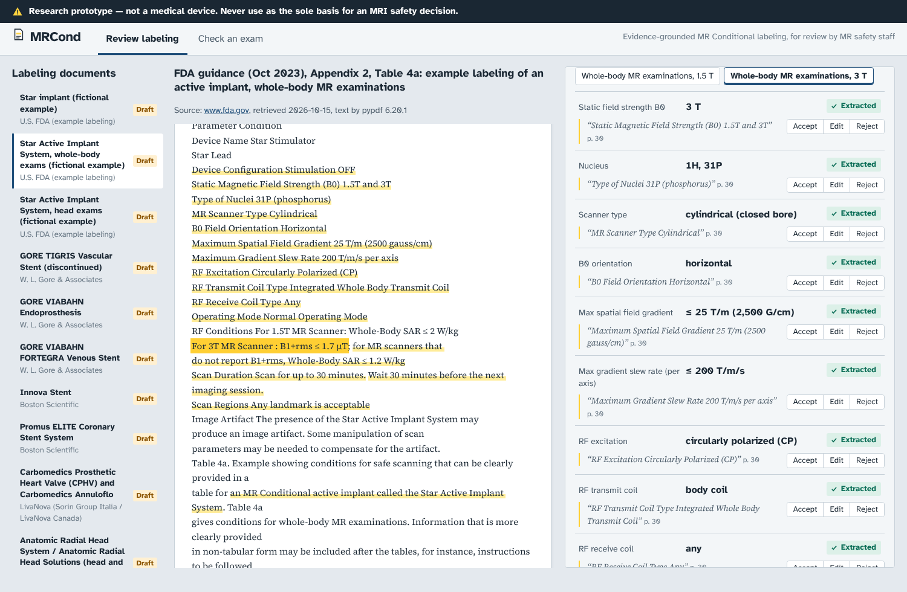
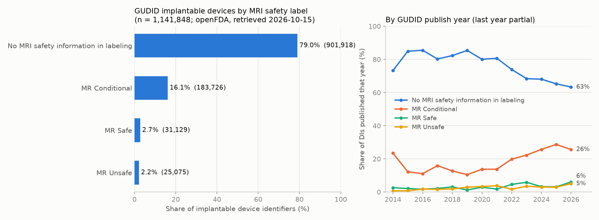
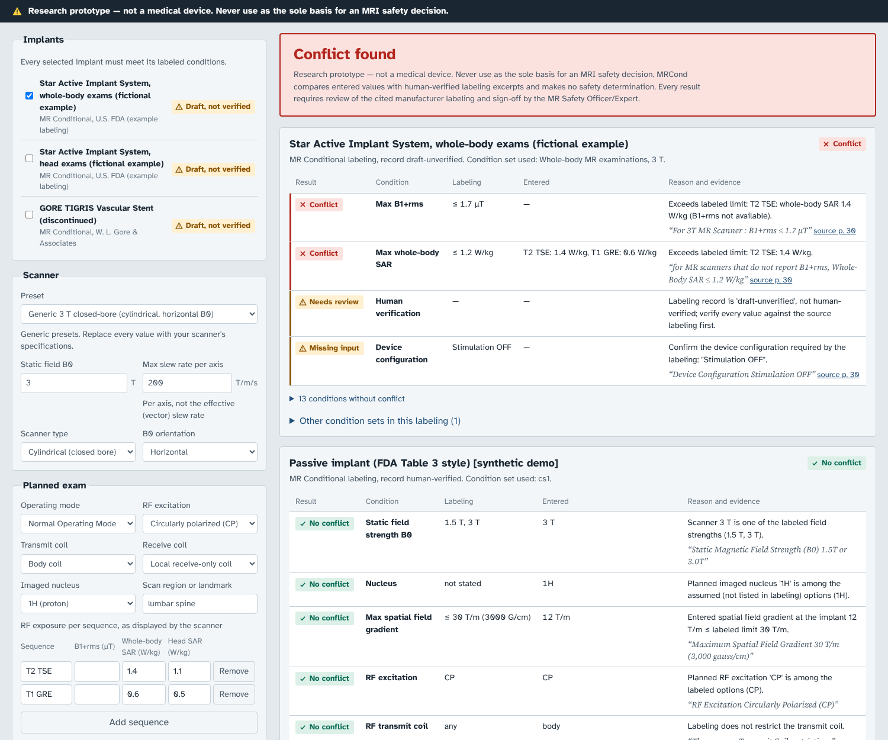
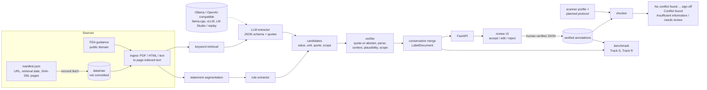

# MRCond

**An open benchmark and evidence-grounded pipeline for MR Conditional implant labeling.**

> **Research prototype — not a medical device. Never use as the sole basis for an MRI safety decision.**
> MRCond never states that a scan is safe. Its best possible outcome is *"No conflict found with entered
> conditions — requires MR Safety Officer/Expert sign-off"*.

MRCond turns the MRI safety section of implant labeling into structured, *evidence-carrying* conditions
(static field strength, spatial field gradient, slew rate, B1+rms / SAR limits, coils, operating mode, scan time,
scan regions, device configuration, ...), lets an MR safety expert verify every value against the source text,
and compares a planned exam with the verified conditions. Every extracted value points to the page, character
offsets and a short verbatim quote it came from; a value whose quote cannot be found verbatim is not used.



## Try it in your browser

[](https://codespaces.new/bizutudor/mrcond?quickstart=1)

The Codespace installs the package, builds the web UI, downloads the public Track R documents (`mrcond fetch`) and
starts the app; the first start takes a few minutes. If no browser tab opens, open port 8000 from the *Ports* tab; if
the app is not running, start it with `mrcond serve`. Things to try:

1. **Review labeling** → *Star Active Implant System, whole-body exams* (FDA example): every extracted condition links
   to its highlighted quote, and each value can be accepted, edited or rejected.
2. **Check an exam** → select the same implant, keep the generic 3 T preset and enter a whole-body SAR above the
   labeled 1.2 W/kg (for example 1.4 W/kg): the result is *Conflict found*, with the quote that sets the limit.
   Clear a required value and the result becomes *Insufficient information / needs review*, never a pass.
3. In the terminal: `mrcond scenarios` (checker suite: 0 unsafe results) and `pytest`.

---

## Why

* **The conditions are not machine-readable anywhere.** In the FDA Global Unique Device Identification Database
  (GUDID), queried through openFDA on 15 Oct 2026 (dataset last updated 1 Oct 2026;
  [query](https://api.fda.gov/device/udi.json?search=gmdn_terms.implantable:true&count=mri_safety.exact)),
  **79.0 %** of the 1,141,848 implantable device identifiers are listed as *"Labeling does not contain MRI Safety
  Information"*, **16.1 %** as MR Conditional, **2.7 %** as MR Safe and **2.2 %** as MR Unsafe. GUDID stores only
  this category; the conditions themselves live in manufacturer PDFs and web pages. We found no open,
  machine-readable source of MR Conditional *conditions*. Even among identifiers published in 2025, 65.3 % had no MRI safety
  information and 28.7 % were MR Conditional (2016: 85.5 % and 11.1 %; per-year counts in [`reports/`](reports/),
  figure below).
* **General-purpose AI is not reliable here.** Rose et al. (medRxiv preprint, October 2025,
  [10.1101/2025.10.16.25336153](https://www.medrxiv.org/content/10.1101/2025.10.16.25336153v1)) compared answers to
  30 real MR-safety queries (a representative subset of 141 logged requests): answers acceptable for clinical use
  came from the human MR safety expert in 93 % of cases, Google AI Overview in 50 % and ChatGPT-4o in 43 % (22 % for
  active implants); both AI systems gave some unsafe advice.
* **The target format is now standardised.** The FDA final guidance *Testing and Labeling Medical Devices for Safety
  in the MR Environment* (October 2023, [PDF](https://www.fda.gov/media/74201/download)) recommends a table of
  conditions (Tables 4a/4b): device configuration (e.g. "Stimulation OFF"); static field strength B0, nucleus,
  scanner type and B0 orientation; maximum spatial field gradient (T/m and G/cm); maximum slew rate per axis; RF
  excitation, transmit and receive coil; operating mode; RF limits per field strength with a SAR fallback (e.g.
  "B1+rms ≤ 1.7 µT; for MR scanners that do not report B1+rms, Whole-Body SAR ≤ 1.2 W/kg"); scan duration and wait
  time; scan regions/exclusion zones; image artifact. Temperature rise is not required in the label. Most existing
  ("legacy") labels use non-standard wording, which is what makes extraction hard.
* **Existing tools are closed.** Reference databases (MagResource, MRIsafety.com) are commercial or closed, and
  scanner features such as Philips ScanWise Implant and Siemens myExam Implant Suite *enforce* limits once a person
  has typed them in; they do not extract them. We found no public benchmark for extracting MR Conditional
  parameters. A 2026 ECR abstract (Kreutzer et al., [*AI-Supported MR Safety Assessment of Implanted Devices: First
  Clinical Evaluation*](https://connect.myesr.org/?p=231788)) reported a retrieval-augmented GPT-4.1 agent that was
  correct in 15/19 cases and flagged missing documentation in the other 4 — encouraging, but not reproducible without
  open data.
* **Practice varies.** The ESR survey *The European MR safety landscape* (Insights into Imaging 2024; 793
  respondents from 44 countries, [record](https://doaj.org/article/cefef5e18fd444208cc4f7e099fbc101)) documents how
  heterogeneous MR safety organisation and implant screening still are.



## What MRCond is

| Component | What it does |
|---|---|
| `mrcond` Python package (3.11+, pydantic v2) | data model + JSON Schema, unit normalisation, PDF/HTML/text ingestion, extractors, verifier, conservative merge, checker, benchmark, GUDID gap analysis, REST API, CLI |
| Rule extractor | regular expressions + units + context windows (field-strength scopes, table columns, negations, test descriptions) |
| LLM extractor | JSON-schema-constrained output with mandatory verbatim quotes; backends: **Ollama**, any **OpenAI-compatible** server (llama.cpp `llama-server`, llama-cpp-python, vLLM, LM Studio) and a deterministic **replay** backend for tests/CI |
| Verifier | quote-or-abstain, value/unit parse check, context check, plausibility ranges, field-strength scope check; failures become `NEEDS_REVIEW` |
| Checker | implants × scanner profile × planned protocol → per-condition PASS / FAIL / INSUFFICIENT_INFO / NEEDS_REVIEW with reasons and evidence; never "safe" |
| Benchmark | Track S (synthetic, exact ground truth) and Track R (real public labeling, draft annotations), metrics incl. the safety-critical *less-conservative error rate*; 73-scenario checker suite; randomised checker test against an independent oracle |
| Web UI (React + TypeScript + Vite) | review page (MR Safety Officer workflow and annotation tool) and checker page |



## Architecture



Source layout: `src/mrcond/` (`schema.py`, `units.py`, `textnorm.py`, `ingest.py`, `extractors/{rule,llm,backends}.py`,
`verifier.py`, `merge.py`, `assemble.py`, `checker.py`, `benchmark/{synth,metrics,scenarios,runner}.py`, `corpus.py`,
`gudid.py`, `api.py`, `cli.py`), `web/` (UI), `data/` (manifest, annotations, synthetic corpus, scenarios, LLM
replays, public-domain text), `schemas/` (exported JSON Schemas), `reports/`, `scripts/`, `tests/`.

## Data model

A `LabelDocument` (one device, one labeling source) has an MR status (`MR Conditional | MR Safe | MR Unsafe | Not
stated`) and a list of `ConditionSet`s — *alternative* sets of conditions, usually one per field strength, sometimes
per configuration (e.g. whole-body vs head-only examinations). Each condition is a `FieldValue`:

```json
"b1rms_max_uT": {
  "status": "EXTRACTED",
  "value": 1.7, "unit": "μT",
  "normalized_value": 1.7, "normalized_unit": "uT", "comparator": "le",
  "evidence": [{"doc_id": "fda-guidance-2023-t4a", "page": 30, "char_start": 853, "char_end": 888,
                "quote": "For 3T MR Scanner : B1+rms ≤ 1.7 μT", "verified": true}]
}
```

`status` is `EXTRACTED`, `NOT_STATED` or `NEEDS_REVIEW` (abstention). Fields: `b0_tesla`, `nucleus`,
`scanner_type`, `b0_orientation`, `max_sfg_t_per_m`, `max_slew_rate_t_per_m_per_s`, `rf_excitation`,
`transmit_coil`, `receive_coil`, `operating_mode`, `b1rms_max_uT`, `wb_sar_max_w_per_kg`, `head_sar_max_w_per_kg`,
`sar_is_b1rms_fallback`, `max_active_scan_time_min`, `wait_time_min`, `scan_region_restrictions`,
`device_configuration`, `artifact_extent_mm`, `other_conditions`. Canonical units: T, T/m (1 T/m = 100 G/cm), T/m/s,
µT, W/kg, min, mm. JSON Schemas: [`schemas/label_document.schema.json`](schemas/label_document.schema.json),
[`check_request`](schemas/check_request.schema.json), [`check_result`](schemas/check_result.schema.json).

## Safety design rules

These rules are implemented in code and covered by tests:

1. **Decision support only.** Outcomes are limited to *"No conflict found with entered conditions — requires MR
   Safety Officer/Expert sign-off"*, *"Conflict found"* and *"Insufficient information / needs review"*. Tests scan
   every checker output for safety claims. The UI shows a sign-off block for the first outcome and a persistent
   banner on every page.
2. **Evidence or abstain.** Every value carries document id, page, character offsets and a quote of at most 25
   words. The verifier rejects a value whose quote is not found verbatim (whitespace- and typography-normalised,
   case-sensitive; digits, decimal separators and units are never altered), whose number and unit cannot be parsed
   from the quote (e.g. "2500 T/m" from "25 T/m (2500 gauss/cm)"; a bare table number counts only if it is not part
   of another quantity, so "For 3T: Whole-Body SAR ≤ 2 W/kg" does not support 3 W/kg), whose quote does not mention
   the quantity (a head-SAR sentence used for whole-body SAR, an *effective* slew rate used as per-axis), a "no
   limit" or "any coil" claim without such wording, a negated status ("not MR Safe"), a value outside plausible
   ranges, or a value quoted from a line scoped to another field strength ("For 1.5T MR Scanner: Whole-Body SAR ≤ 2
   W/kg" applied to 3 T). The field becomes `NEEDS_REVIEW`.
3. **Most conservative merge.** Several statements about the same field in one condition set merge to the most
   restrictive value (lowest SAR/B1+rms/gradient/slew/time limit, longest wait, intersection of permitted
   coils/excitations/nuclei, the lower operating mode); a statement that cannot be read makes the field
   `NEEDS_REVIEW`. Each permitted field strength gets its own condition set, and statements scoped to one field
   strength never enter another set. Several implants: every implant must pass and the overall result is the most
   conservative; condition sets of one implant are alternatives (per field strength or configuration).
4. **Nothing is assumed; position-dependent questions go to a person.** A condition is "no conflict" only if the
   user entered a value that meets it: a missing exam value (nucleus, scanner type, B0 orientation, coil, mode,
   per-sequence RF values, scan time, wait time) gives "insufficient information". A spatial-field-gradient
   condition is `NEEDS_REVIEW` unless the user enters the gradient at the implant location. Scan-region restrictions
   and other free-text conditions (patient conditions, time since implantation, ...) are always `NEEDS_REVIEW`
   (only an explicit "any landmark"/"no restriction" passes). A required device configuration (e.g. "Therapy OFF")
   must be confirmed; "not configured" is a conflict. Records that are not human-verified are flagged.
5. **RF logic.** B1+rms is checked per sequence; a SAR limit marked as B1+rms fallback is used only for sequences
   without B1+rms; when both values are reported both are checked (stricter than the label); a SAR limit that is not a
   fallback must always be met; SAR alone never satisfies a label that only gives a B1+rms limit.
6. **Invalid input is rejected.** NaN, infinite, negative and physically absurd entries are refused by the API
   (HTTP 422) and flagged in the UI; a labeled limit that is not a number is `NEEDS_REVIEW`. Limits are inclusive (≤),
   with a 1e-9 tolerance so that a value exactly at a limit never becomes a conflict through floating-point noise.
7. **No redistribution.** Manufacturer documents are not committed: the manifest stores URL, retrieval date, SHA-256
   and page references, and `mrcond fetch` downloads them. Annotations store offsets and short quotes only. US
   federal (FDA) documents are public domain and their relevant pages are included. Recorded LLM outputs keep only
   the model output with quotes capped at 25 words. No ASTM standard text is used anywhere in the pipeline (ASTM
   prohibits AI use of its standards).

How these rules were tested is summarised in [`docs/VALIDATION.md`](docs/VALIDATION.md).

## Quickstart

```bash
# backend
python3.11 -m venv .venv && source .venv/bin/activate
pip install -e ".[dev,reports]"
pytest                                    # unit, verifier, checker-scenario, API tests (offline)

# data
mrcond fetch                              # download the Track R documents listed in data/corpus/manifest.json
mrcond extract fda-guidance-2023-t4a --extractor rule+verifier     # or a path to any PDF/HTML/TXT
mrcond scenarios                          # checker scenario suite (must report "unsafe_pass": 0)
mrcond bench --tracks S R --extractors rule rule+verifier          # quick run -> reports/quick/
python scripts/benchmark_report.py        # full benchmark incl. recorded LLM outputs; also refreshes README tables
mrcond gudid                              # openFDA gap analysis -> reports/ (use --offline for the snapshot)

# web UI (production mode: the API serves the built UI)
npm --prefix web ci && npm --prefix web run build
mrcond serve                              # http://127.0.0.1:8000  (local use only, no authentication)

# UI development with hot reload (proxies /api to :8000)
npm --prefix web run dev                  # http://127.0.0.1:5173
npm --prefix web run typecheck && npm --prefix web test
```

When adding web dependencies, npm 10 can crash on vitest's optional peer dependencies ("Cannot read properties of
null (reading 'edgesOut')"); `npm install --legacy-peer-deps <package>` works, and the committed lockfile still
installs with a plain `npm ci`.

### Using a local LLM

Any OpenAI-compatible server works. With llama.cpp:

```bash
llama-server -m qwen2.5-7b-instruct-q4_k_m.gguf -c 8192 --port 8080
mrcond bench --tracks S R --extractors llm llm+verifier \
  --llm-backend openai --llm-base-url http://127.0.0.1:8080/v1 --llm-model qwen2.5-7b-instruct \
  --llm-record data/replay/qwen2.5-7b-instruct.jsonl --llm-limit 30
```

* llama-cpp-python's server (`python -m llama_cpp.server --model ... --port 8080`) expects the schema as
  `{"type": "json_object", "schema": ...}`: add `--llm-schema-mode json_object`. If a server rejects schemas,
  `--llm-schema-mode none` falls back to prompt-only JSON.
* Ollama: `ollama pull qwen2.5:7b-instruct`, then `--llm-backend ollama --llm-model qwen2.5:7b-instruct`.
* vLLM and LM Studio: `--llm-backend openai` with their base URL.
* Recordings store only the model output (including the quotes the model copied, capped at 25 words by
  `scripts/cap_replay_quotes.py`; a test enforces the cap) and a hash of the prompt — never the prompt or the
  document text — so results can be re-scored without the model (a test checks that the recorded prompt hashes match
  the current prompt):
  `--llm-backend replay --llm-replay data/replay/<tag>.jsonl --llm-tag <tag>`.
  `scripts/record_llm_outputs.py` records long runs resumably; `--runs 0 1 2` records one greedy run plus two
  sampled runs at temperature 0.7, which `mrcond bench ... --llm-runs 3` and `scripts/benchmark_report.py` score for
  run-to-run consistency.
* The API uses environment variables: `MRCOND_LLM_BACKEND=openai MRCOND_LLM_BASE_URL=http://127.0.0.1:8080/v1
  MRCOND_LLM_MODEL=qwen2.5-7b-instruct mrcond serve`, then choose "Local LLM + verifier" on the review page. To
  browse the recorded extractions without a model: `MRCOND_LLM_BACKEND=replay
  MRCOND_LLM_REPLAY=data/replay/qwen2.5-3b-instruct-q4_k_m.jsonl mrcond serve`.

The model only locates evidence and copies values; MRCond does all unit conversion. If the model returns a field
and a quote but no usable number, MRCond parses the value from the model's own quote (counted as
`llm:value-from-quote`), and the verifier still applies.

## Benchmark

**Track S — synthetic, exact ground truth** (`data/benchmark/track_s/`, 200 documents, seed 20261015, 100 dev /
100 test). A generator samples ground-truth condition sets and renders them in five styles (FDA two-column table,
per-field-strength column table, legacy bullets, prose with per-field-strength sections, one dense sentence) with
paraphrase and format variation (T/m vs G/cm, µT/μT/uT/microtesla, comparator wording, thousands separators,
hyphenated units, SAR fallback wording, missing fields, multi-page layout) and distractors (temperature-rise results,
test descriptions naming other field strengths, device dimensions, gradient amplitude in mT/m, "do not scan at 7 T",
post-implantation waiting periods). Character offsets of every rendered value are recorded, so gold evidence is exact.
Track S measures robustness to *known* template variation; it does not measure generalisation: the rule extractor
was written by the same author as the templates. It was developed on the dev split only; the test split was scored
for the first time when the extractor was frozen (15 Oct 2026). Later changes that can affect the scores are listed
under "Post-hoc changes" below.

**Track R — real public labeling** ([`data/corpus/manifest.json`](data/corpus/manifest.json)): 24 publicly accessible
documents — the three FDA guidance example tables and 21 documents from 14 manufacturers (peripheral, coronary and
venous stents, stent graft, heart valve, IVC filters, aneurysm clip, cranial plates, orthopaedic implants, LAA clip,
insertable cardiac monitors, pacemaker systems, spinal cord stimulators, a subdermal NFC implant), retrieved 15 Oct
2026 with SHA-256. **21 documents have draft annotations** (`data/annotations/track_r/`), marked `"verification": "draft-unverified"`
with annotator `assistant-draft`; they were written by an AI assistant from the documents and **must be reviewed by
a person before being called gold**. Three long spinal-cord-stimulator manuals are listed but not yet annotated.

**Metrics** (`src/mrcond/benchmark/metrics.py`). Labels are compared per (field strength, field) slot after flattening
condition sets (numeric limits merged conservatively). Field-level precision / recall / F1 (numeric tolerance 1 %;
field-strength keys must match; categorical sets must be equal; free text by token-F1 ≥ 0.5 or overlapping evidence);
**unsupported-value rate** (extracted values whose quotes are not found verbatim); **less-conservative error count
and rate** — predictions more permissive than the labeling: a higher upper limit, a shorter wait, an extra field
strength, a more permissive coil/mode/excitation set, a dropped scan-region restriction, a SAR limit wrongly marked
as B1+rms fallback, a stated constraint that was missed, or a more permissive MR status (MR Unsafe < not stated <
MR Conditional < MR Safe, the order in which the checker treats them); a predicted field strength inside a gold
"X T or less" range is also compared with that range's limits (rate = errors / gold-stated slots); **abstention
rate** and **selective accuracy** (accuracy on non-abstained slots); **run-to-run consistency** for stochastic
backends (share of slots on which all runs agree).

### Current results

All numbers below are generated by `python scripts/benchmark_report.py` from
[`reports/benchmark_results.json`](reports/benchmark_results.json) (MRCond 0.1.0, prompt v2, 15 Oct 2026); LLM
results are re-scored from the recorded outputs in `data/replay/`, so no model is needed to reproduce them.

* **Rule extractor:** Track S test split (100 documents) and Track R (21 documents).
* **Local LLMs:** Qwen2.5-1.5B-Instruct and Qwen2.5-3B-Instruct, GGUF Q4_K_M (official Qwen GGUF files), served by
  llama-cpp-python 0.3.36 on CPU only (2 vCPU Intel Xeon 2.1 GHz, 8 GB RAM; about 1.5–2 min per document),
  n_ctx 8192, greedy decoding (temperature 0, seed 0), at most 1000 output tokens, JSON schema passed as
  `response_format` (`json_object`), prompt v2 with keyword-retrieved context of at most 6000 characters. Both models
  ran on all 21 Track R documents and on the first 30 Track S test documents (synth-20261015-0100 to -0129); the rule
  extractor on the same 30 documents is shown for comparison. Run-to-run consistency: 1.5B only, two extra sampled
  runs (temperature 0.7, seeds 1 and 2) on the first 10 Track R documents, compared with the greedy run.
* **Track R scores are measured against draft annotations written by an AI assistant, pending human verification.**

<!-- results:start (generated by scripts/benchmark_report.py from reports/benchmark_results.json) -->

**Track S — synthetic test split** (100 documents)

| Extractor | Docs | Precision | Recall | F1 | MR status acc. | Unsupported values | Less-conservative errors (rate) | Abstention | Selective acc. | Run-to-run consistency |
|---|---|---|---|---|---|---|---|---|---|---|
| rule | 100 | 96.6 % | 98.6 % | 97.6 % | 100.0 % | 0/856 | 6 (0.6 %) | 0.0 % | 96.3 % | deterministic |
| rule + verifier | 100 | 100.0 % | 94.1 % | 96.9 % | 100.0 % | 0/798 | 3 (0.3 %) | 7.9 % | 99.7 % | deterministic |
| rule (LLM subset, 30 docs) | 30 | 98.6 % | 99.6 % | 99.1 % | 100.0 % | 0/238 | 0 (0.0 %) | 0.0 % | 98.6 % | deterministic |
| rule + verifier (LLM subset, 30 docs) | 30 | 100.0 % | 98.2 % | 99.1 % | 100.0 % | 0/230 | 0 (0.0 %) | 2.9 % | 100.0 % | deterministic |
| LLM, qwen2.5-1.5b-instruct-q4_k_m | 30 | 78.9 % | 40.9 % | 53.8 % | 0.0 % | 12/97 | 121 (44.2 %) | 0.0 % | 37.7 % | — |
| LLM + verifier, qwen2.5-1.5b-instruct-q4_k_m | 30 | 96.5 % | 30.7 % | 46.5 % | 0.0 % | 0/59 | 118 (43.1 %) | 14.8 % | 33.1 % | — |
| LLM, qwen2.5-3b-instruct-q4_k_m | 30 | 93.9 % | 73.0 % | 82.1 % | 20.0 % | 32/152 | 46 (16.8 %) | 0.0 % | 70.7 % | — |
| LLM + verifier, qwen2.5-3b-instruct-q4_k_m | 30 | 98.7 % | 56.2 % | 71.6 % | 10.0 % | 0/110 | 43 (15.7 %) | 15.2 % | 64.2 % | — |

Less-conservative errors by kind:

* rule: SAR wrongly marked as B1+rms fallback 3, missed constraint 3
* rule + verifier: missed constraint 3
* LLM, qwen2.5-1.5b-instruct-q4_k_m: higher limit 5, missed constraint 113, more permissive MR status 3
* LLM + verifier, qwen2.5-1.5b-instruct-q4_k_m: missed constraint 118
* LLM, qwen2.5-3b-instruct-q4_k_m: extra field strength 2, higher limit 1, missed constraint 41, more permissive MR status 2
* LLM + verifier, qwen2.5-3b-instruct-q4_k_m: extra field strength 2, missed constraint 41

**Track R — real labeling, draft annotations pending human verification** (21 documents)

| Extractor | Docs | Precision | Recall | F1 | MR status acc. | Unsupported values | Less-conservative errors (rate) | Abstention | Selective acc. | Run-to-run consistency |
|---|---|---|---|---|---|---|---|---|---|---|
| rule | 21 | 92.6 % | 85.2 % | 88.8 % | 85.7 % | 0/193 | 12 (4.3 %) | 0.0 % | 82.6 % | deterministic |
| rule + verifier | 21 | 93.2 % | 83.8 % | 88.3 % | 85.7 % | 0/188 | 12 (4.3 %) | 2.1 % | 82.9 % | deterministic |
| LLM, qwen2.5-1.5b-instruct-q4_k_m | 21 | 75.2 % | 29.5 % | 42.4 % | 33.3 % | 21/69 | 141 (50.7 %) | 0.0 % | 27.4 % | 34.3 % (10 docs × 3 runs) |
| LLM + verifier, qwen2.5-1.5b-instruct-q4_k_m | 21 | 97.9 % | 16.9 % | 28.8 % | 28.6 % | 0/32 | 135 (48.6 %) | 17.4 % | 19.0 % | 26.0 % (10 docs × 3 runs) |
| LLM, qwen2.5-3b-instruct-q4_k_m | 21 | 91.0 % | 54.7 % | 68.3 % | 23.8 % | 26/108 | 83 (29.9 %) | 0.0 % | 52.6 % | — |
| LLM + verifier, qwen2.5-3b-instruct-q4_k_m | 21 | 98.2 % | 40.3 % | 57.1 % | 14.3 % | 0/73 | 78 (28.1 %) | 15.4 % | 46.3 % | — |

Less-conservative errors by kind:

* rule: extra field strength 1, higher limit 3, missed constraint 7, more permissive MR status 1
* rule + verifier: extra field strength 1, higher limit 3, missed constraint 7, more permissive MR status 1
* LLM, qwen2.5-1.5b-instruct-q4_k_m: higher limit 6, missed constraint 135
* LLM + verifier, qwen2.5-1.5b-instruct-q4_k_m: missed constraint 135
* LLM, qwen2.5-3b-instruct-q4_k_m: extra field strength 1, higher limit 4, missed constraint 78
* LLM + verifier, qwen2.5-3b-instruct-q4_k_m: higher limit 1, missed constraint 77

<!-- results:end -->

How to read this:

* The small local models miss most conditions, so "missed constraint" dominates their less-conservative errors
  (e.g. 77 of 78 for the 3B model with verifier on Track R). After verification no extracted value lacks verbatim
  evidence, but recall drops. The worked example in prompt v2 has `"mr_status": "Not stated"` and both models copy it
  (in 46 and 43 of 51 recorded documents), which explains their low MR-status accuracy; fixing the prompt requires
  new recordings.
* The rule extractor is close to perfect on its own synthetic templates and lower on real labeling; its Track R
  less-conservative errors (12) include 3 higher limits, 1 extra field strength, 7 missed constraints and 1 MR
  status taken from a sentence about *other* devices.
* Checker: 73 hand-written scenarios with 0 mismatches and 0 unsafe "No conflict found", and a randomised test of
  6,000 label/exam combinations against an independent oracle with 0 disagreements (`tests/test_checker_properties.py`).

**Post-hoc changes** (after the Track S test split was first scored and the rule extractor frozen):

* By the author, before these numbers: the unit parser gained T/s (dB/dt) and T²/m dimensions after the first Track R
  run ("60 T/s" had been read as a 60 T field strength; shared with the rule extractor); verifier check 6 (field-strength
  scope) was added after inspecting LLM errors on Track R; the metrics gained field-strength range alignment and
  stopped counting an unlisted 1H nucleus as a missed constraint; the LLM prompt went from v1 to v2 after a smoke run
  (v1 outputs were discarded; every recording uses v2).
* During the QA review (October 2026, [`docs/VALIDATION.md`](docs/VALIDATION.md)): verifier hardening (see safety rule 2, plus a check that a
  categorical value is quoted from a sentence about that quantity), a slew-rate unit (G/cm/s, previously read as a
  spatial gradient), conservative handling of unreadable values in the merge and the checker, input validation. On
  the recorded data only one row changed: LLM 3B + verifier on Track S, where two RF-excitation values taken from
  transmit-coil sentences are now rejected (precision 97.5 → 98.7 %, F1 71.3 → 71.6 %, abstention 14.5 → 15.2 %).
  The less-conservative metric was completed with "more permissive MR status" and with field strengths inside a
  gold "X T or less" range, which added 1–3 errors to five rows (Track S: LLM 1.5B 118 → 121, LLM 3B 44 → 46;
  Track R: rule 11 → 12, rule + verifier 11 → 12, LLM 3B 82 → 83). Fourteen recorded quotes longer than 25 words
  were capped; all metrics are identical before and after capping.

## Contributing annotations

The review page is also the annotation tool. To verify a draft (or to annotate a new document):

1. `mrcond fetch`, `mrcond serve`, open http://127.0.0.1:8000, pick a document.
2. For every condition: click the row to highlight its evidence, then **Accept**, **Edit** (enter the value as
   stated, its unit and a verbatim quote of at most 25 words — select the text in the document and press "Use text
   selected in the document") or **Reject**. "Show conditions not stated in this document" lets you add missing ones.
3. Enter your name and **Save verified annotation**. The API checks every edited quote against the text and writes
   `data/annotations/verified/<doc_id>.json` (status `human-verified`, reviewer, timestamp) plus an audit log line.

Guidelines used for the drafts (`scripts/build_draft_annotations.py`): annotate conditions for scanning patients
only, never test conditions or results (temperature rise, phantom SAR, test durations); a duration attached to a
condition ("SAR of 2 W/kg for 15 minutes of scanning") is a scan-time condition, a duration in a heating-result
sentence is not; record the MR status only when the text uses the term; one condition set per field strength when
limits differ and alternative sets for configuration- or landmark-dependent limits; strict "<" limits are recorded
as upper limits; configuration-dependent values inside one set take the most conservative value with a note in
`other_conditions`. To add a document, append a manifest entry (URL, retrieval date, SHA-256, pages and an optional
`section` with verbatim start/end anchors for multi-device or multilingual documents) and annotate it in the UI.
Please never commit manufacturer files or long excerpts.

## Limitations

* Track R annotations are **drafts by an AI assistant, not yet verified by a person**; Track R numbers are
  provisional. The corpus is small (21 annotated documents) and English-only.
* The rule extractor scores well on the synthetic, FDA-style templates it was developed with, and lower on real
  layouts (Track R): text-layer artefacts
  (missing spaces, "≤" rendered as "¢"), line breaks inside phrases ("MR" / "Conditional"), landmark-dependent
  sub-bullets, HTML tables split across lines and test descriptions next to conditions.
* Legacy labels are ambiguous (e.g. a static-field row listing 3.0 T while other rows give 1.5 T limits); MRCond
  records the conservative reading and flags it, but a person must decide.
* MRCond does not compute spatial-field-gradient exposure from patient position or scanner SFG maps, does not model
  RF heating, and does not interpret free-text scan-region restrictions.
* Labels change over time: retrieval dates and SHA-256 are recorded; always check the current labeling.
* The local LLM results come from small quantised models (1.5B and 3B parameters) on a 2-core CPU with one prompt
  version, on 21 real and 30 synthetic documents; they say little about 7B-70B local models, which have not been run
  yet.
* The checker compares nominal field strengths with a tolerance of ±0.05 T: a 1.494 T scanner matches a "1.5 T"
  label, while entering 2.89 T for a nominal 3 T scanner gives a conflict with a "3 T" label.
* Following the FDA 2023 guidance ("if a parameter is not listed, no modifications of that parameter are needed"),
  an unlisted parameter is not a condition; only an unlisted nucleus means 1H only. Older labels written before this
  convention (e.g. silent on RF excitation or transmit coil) need a person's judgement.
* The review workflow keeps values the reviewer does not touch: saving a draft makes all its remaining values
  "human-verified" under the reviewer's name. The API (`POST /api/check`) also accepts label records inline, and
  their provenance is not authenticated — it is a local tool without user accounts.

## Regulatory note

MRCond is a research prototype, **not a medical device**, not CE-marked or FDA-cleared, and not clinically
validated. It is designed as decision support in the spirit of the criteria for non-device CDS in the FDA guidance
[*Clinical Decision Support Software*](https://www.fda.gov/media/109618/download) (final guidance 2022, current
version issued 29 January 2026) — in particular that a health-care professional must be able to independently
review the basis of every output (here: the cited page, offsets and verbatim quote) — but no regulatory
determination has been made. Under the EU MDR, software that provides information used for diagnostic or therapeutic
decisions is classified at least class IIa under Rule 11 (see MDCG 2019-11); any clinical use of a tool like this
would require qualification, classification and conformity assessment by its manufacturer. Never use MRCond as the
sole basis for an MRI safety decision.

## Roadmap

* Expand Track R to 100+ documents with two independent annotators and inter-annotator agreement; adjudicate the
  current drafts.
* Compare local LLMs (Qwen, Llama, Mistral families; 7B-70B; llama.cpp / Ollama) with recorded, replayable outputs.
* Link labels to GUDID device identifiers (DI) and track label versions over time.
* FHIR export (e.g. `DeviceDefinition` / `Device` with MR conditions as extensions) for scanner and RIS integration.
* An ISMRM-style abstract describing the benchmark and the less-conservative error metric.

## Citation

```bibtex
@software{bizu_mrcond_2026,
  author  = {Bizu, Tudor-Costin},
  title   = {MRCond: an open benchmark and evidence-grounded pipeline for MR Conditional implant labeling},
  year    = {2026},
  version = {0.1.0},
  license = {MIT}
}
```

See also [`CITATION.cff`](CITATION.cff).

## License and author

MIT License, Copyright (c) 2026 Tudor-Costin Bizu. openFDA data are CC0; GMDN terms are licensed by the GMDN Agency
(MRCond stores only counts). Manufacturer documents remain the property of their owners and are not redistributed.

**Author:** Tudor-Costin Bizu — M1 Biomedical Engineering, Institut Polytechnique de Paris; former GE HealthCare
trainee on MRI/CT installation and safety checks; builds local LLM/RAG tooling focused on reliability.
